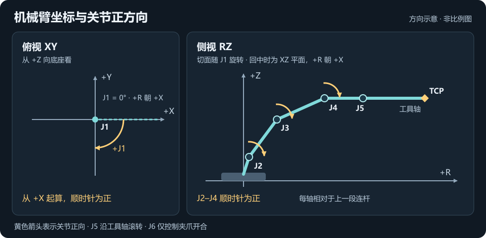

# Servo Arm

五轴机械臂与夹爪，由 STM32F103C8T6 裸机控制，通过 USART1 与上位机通信。J1～J5 驱动机械关节，J6 控制夹爪，J7 为备用。

外设和引脚配置以 [Servo_Arm.ioc](Servo_Arm/Servo_Arm.ioc) 为准。

## 坐标设置与参考姿态



- 底座原点是 J1 轴线与桌面参考面（`Z = 0`）的交点。位置单位为 mm，Z 向上。
- **J1 底座旋转**：XY 俯视图中 +X 向右、+Y 向上。零位朝 +X，顺时针为正；`+90°` 朝 −Y。
- **J2～J4 俯仰**：RZ 侧视图中 +R 向右、+Z 向上。各关节相对上一段连杆，顺时针为正。
- **RZ 切面**随 J1 转动。J1 为 `0°` 时，切面为 XZ，`R = X`。
- **J5 腕滚转**：从 TCP 朝手腕看，绕工具轴逆时针为正。

### 模型参考位置

按回中姿态填写 [model.json](WebHost/model.json)。J1～J5 的关节偏角 `0°` 对应舵机命令 `135°`。工具竖直朝上时末端俯仰为 `0°`，朝 +R 偏转为正。

| 位置 | 参考坐标 (X, Y, Z)，mm | 转轴正方向 |
|---|---|---|
| J1 底座 | `(0, 0, 0)` | `-Z` |
| J2 肩 | `(10, 0, 95)` | `+Y` |
| J3 肘 | `(10, 0, 200)` | `+Y` |
| J4 腕俯仰 | `(10, 0, 290)` | `+Y` |
| J5 腕滚转 | `(10, 0, 360)` | `+Z`（工具轴） |
| TCP 工具中心 | `(10, 0, 463)` | — |

- `joints` 按 J1～J5 排列。`point` 是参考姿态下的轴心，`axis` 按右手定则定义关节正方向。`tcp` 与各轴心使用同一坐标系。
- 对齐实机转向时，只改对应轴的 `commandDirection`。当前 J1、J2 为 `-1`，J3～J5 为 `+1`。保持图示与 `axis` 不变；ADC 反馈极性由固件标定，上位机无需配置。
- `commandLimits` 填舵机命令角，与[固件逐轴限幅](#限幅与失能)同步。夹爪开合预设在 `gripper` 中配置。

## 关节角与串口角

令 `q` 为网页关节偏角，`a` 为串口舵机角，`s` 为 `commandDirection`。

- J1～J5 下发：`a = 135 + s × q`。
- J1～J5 读回：`q = s × (a − 135)`。板端目标和标定后的反馈用同一公式。
- J6 夹爪直接用舵机角。
- 例如 J2 的 `+15°` 对应舵机角 `120°`，在线上编码为 `12000`。J2 的舵机限位 `100–216°` 换算后为 `−81° 到 +35°`。

JS 上位机可复用 [arm-model.mjs](WebHost/arm-model.mjs) 的 `jointToServo`、`servoToJoint`、`jointAngleLimits`，共同读取 [model.json](WebHost/model.json)。其他语言按上面的公式转换即可。末端逆解使用同一套关节角，不另设方向。

## 网页使用

在 `WebHost` 目录启动：

```powershell
python -m http.server 8765 --bind 127.0.0.1
```

用桌面 Chrome 打开 [本机调试台](http://127.0.0.1:8765/)，点「连接串口」，选择对应的 COM 口。若端口被占用，先关闭串口助手。

| 操作 | 用法 |
|---|---|
| 单轴调试 | 选轴，填入接近当前姿态的目标，点「发送目标」，再点「使能 PWM」。从小幅移动开始，对照目标、反馈和 ADC 原始值 |
| 整臂示意 | 点关节后拖动滑块，默认只预览。勾选「实机跟随」后，松开滑块会发送目标；「回中」将 J1～J5 设为关节零位 |
| 末端空间控制 | 点 XY 改水平位置，点 RZ 改当前切面内的位置；也可直接填 XYZ（mm）或用 TCP 微调。确认预览并使能所需关节后，点「发送末端目标」 |
| 夹爪 | 使能 J6 后可点「张开」（`60°`）、「闭合」（`133°`），或调滑块后点「发送夹爪角度」 |

侧视绿区表示终点通过模型检查。发送前还会从板端最近接收的目标角检查关节插值。结束前点「全部失能 PWM」，再断开串口。

## 下位机软件架构

| 模块 | 职责 |
|---|---|
| [main.c](Servo_Arm/Core/Src/main.c) | 初始化外设；每 20 ms 调用 `Arm_Update()`，每轮主循环调用 `Arm_ProtocolPoll()` |
| [arm.c](Servo_Arm/Application/Src/arm.c) | 管理 `servo_j1`～`servo_j7` 实例；逐路读取 ADC 并更新控制。ADC 读取失败时跳过本周期该路输出更新 |
| [servo.c](Servo_Arm/Application/Src/servo.c) | ADC 角度换算与滤波、目标限幅、PWM 换算及启停 |
| [servo_config.h](Servo_Arm/Application/Inc/servo_config.h) | PWM 量程、逐轴限位、ADC 标定和外环参数 |
| [uart_io.c](Servo_Arm/Application/Src/uart_io.c) / [arm_protocol.c](Servo_Arm/Application/Src/arm_protocol.c) | USART1 中断收发；主循环解帧、执行命令并应答 |

- TIM1/TIM2 输出 **50 Hz** PWM，计数频率 **3 MHz**。`0–270°` 线性映射到 **500–2500 μs**，`135°` 对应 `1500 μs`。
- SWD 调试：`target_deg` 是设定目标，`command_deg` 是实际 PWM 指令角，`feedback_deg` 是换算并滤波后的反馈角，`feedback_adc` 是原始采样，`pwm_ticks` 是 CCR 计数。

## 限幅与失能

| 轴 | 舵机命令角 |
|---|---|
| J1 底座 | `0–270°` |
| J2 肩 | `100–216°` |
| J3 肘 | `50–260°` |
| J4 腕俯仰 | `83–230°` |
| J5 腕滚转 | `0–270°` |
| J6 夹爪 | `60–133°` |
| J7 备用 | `0–270°` |

- 限位用舵机命令角。在固件改 `SERVO_Jx_OUTPUT_LIMITS` 时，同步更新网页 [commandLimits](WebHost/model.json) 中的在用轴。串口指令中任何选中轴越界，整帧拒绝；本地舵机 API 将输出限制在该轴范围内。
- ADC 外环默认关闭，PWM 指令跟随目标。启用外环后，修正量限制在目标的 `±15°` 内，最终仍受逐轴限位约束。
- ADC 两点标定用 `SERVO_ADC_CALIBRATION(舵机角A, ADC_A, 舵机角B, ADC_B)`。两点 ADC 必须不同，斜率由原始配对决定。当前未填两点数据的轴按配置方向估算反馈角。
- 上电默认不发 PWM。失能时清零 PWM 输出并保留目标角；它只停止控制信号，舵机仍通电。断开串口会保留板端的目标和 PWM 使能状态。

## USART1 协议

- 串口：`115200 / 8N1`，无流控。多字节整数均为小端序。
- 帧格式：`AA 55 | 02 | type:u8 | seq:u16 | len:u16 | payload | crc:u16`。同步字固定为 `AA 55`，版本字节固定为 `0x02`。`len` 只计载荷，范围 `0–512` 字节；应答原样返回 `seq`。
- CRC：CRC-16/CCITT-FALSE，覆盖 `02` 至载荷末尾。多项式 `0x1021`、初值 `0xFFFF`、不反射、结果异或 `0x0000`。

| 请求 | 载荷 | 应答 |
|---|---|---|
| `0x01 SET_TARGETS` | `mask:u8 + 6 × angle:u16`，固定 13 字节；只更新选中轴 | `0x80 ACK` |
| `0x02 SET_ENABLE` | `mask:u8 + enable:u8`，`0` 关闭 PWM，`1` 使能 | `0x80 ACK` |
| `0x03 READ_FEEDBACK` | 无 | `0x81 FEEDBACK` |
| `0x04 PING` | 任意 `0–512` 字节 | `0x84 PONG`，原样返回载荷 |

- **轴序和角度**：掩码 bit 0～5 依次为 J1～J6，其余位为 0，掩码不能为 0。目标及反馈数组同序。角度用无符号舵机角，单位 `0.01°`，如 `133° → 13300`。
- **ACK**：`请求类型:u8 + 状态:u8`。状态 `0` 已处理、`1` 长度错误、`2` 参数无效或越界、`3` 未知命令。ACK 不表示到位。
- **FEEDBACK**：38 字节，`使能掩码:u8 + 已采样掩码:u8`，再按轴重复 `目标角:u16 + 反馈角:u16 + ADC 原始值:u16`。已采样位表示该轴曾取得有效 ADC 采样。
