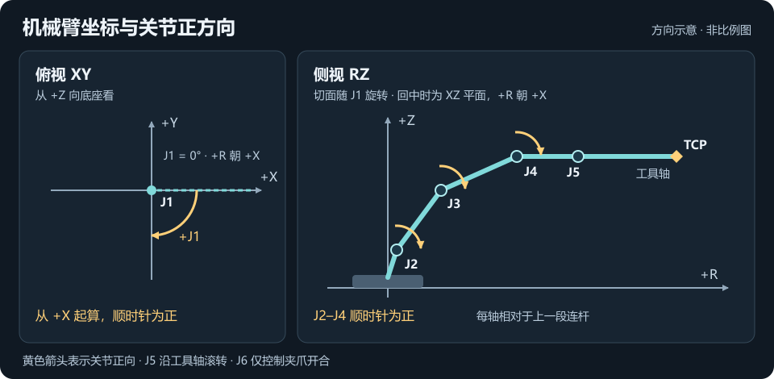

# 坐标设置与参考姿态

## 底座坐标

- 底座原点是 J1 轴线与桌面参考面（`Z = 0`）的交点。位置单位为 mm，Z 向上。
- **J1 底座旋转**：XY 俯视图中 +X 向右、+Y 向上。零位朝 +X，顺时针为正；`+90°` 朝 −Y。
- **J2～J4 俯仰**：RZ 侧视图中 +R 向右、+Z 向上。各关节相对上一段连杆，顺时针为正。
- **RZ 切面**随 J1 转动。J1 为 `0°` 时，切面为 XZ，`R = X`。
- **J5 腕滚转**：从 TCP 朝手腕看，绕工具轴逆时针为正。

## 模型参考位置

按回中姿态填写 [model.json](model.json)。J1～J5 的关节偏角 `0°` 对应舵机命令 `135°`。工具竖直朝上时末端俯仰为 `0°`，朝 +R 偏转为正。

| 位置 | 参考坐标 (X, Y, Z)，mm | 转轴正方向 |
|---|---|---|
| J1 底座 | `(0, 0, 0)` | `-Z` |
| J2 肩 | `(10, 0, 95)` | `+Y` |
| J3 肘 | `(10, 0, 200)` | `+Y` |
| J4 腕俯仰 | `(10, 0, 290)` | `+Y` |
| J5 腕滚转 | `(10, 0, 360)` | `+Z`（工具轴） |
| TCP 工具中心 | `(10, 0, 463)` | — |

- `joints` 按 J1～J5 排列。`point` 是参考姿态下的轴心，`axis` 按右手定则定义关节正方向。`tcp` 与各轴心使用同一坐标系。
- 对齐实机转向时，只改对应轴的 `commandDirection`。当前 J1、J2 为 `-1`，J3～J5 为 `+1`。保持图示与 `axis` 不变；ADC 反馈极性由固件标定，上位机无需配置。
- `commandLimits` 填舵机命令角，与[固件逐轴限幅](../Servo_Arm/README.md#限幅与失能)同步。夹爪开合预设在 `gripper` 中配置。

## 关节角与串口角

令 `q` 为网页关节偏角，`a` 为串口舵机角，`s` 为 `commandDirection`。

- J1～J5 下发：`a = 135 + s × q`。
- J1～J5 读回：`q = s × (a − 135)`。板端目标和标定后的反馈用同一公式。
- J6 夹爪直接用舵机角。张开发送 `60°`，闭合发送 `133°`。
- 例如 J2 的 `+15°` 对应舵机角 `120°`，在 V2 中编码为 `12000`。J2 的舵机限位 `100–216°` 换算后为 `−81–35°`。

JS 上位机可复用 [arm-model.mjs](arm-model.mjs) 的 `jointToServo`、`servoToJoint`、`jointAngleLimits`，共同读取 [model.json](model.json)。其他语言按上面的公式转换即可。末端逆解使用同一套关节角，不另设方向。

网页侧视绿区是简化模型通过终点检查的候选区域。发送末端目标前还会检查关节插值，起点取板端最近接收的目标角。

从 `WebHost` 目录运行 `python -m http.server 8765 --bind 127.0.0.1`，在桌面 Chrome 打开 [本机调试台](http://127.0.0.1:8765/)。串口格式见 [USART1 协议 V2](../Servo_Arm/README.md#usart1-协议-v2)。
