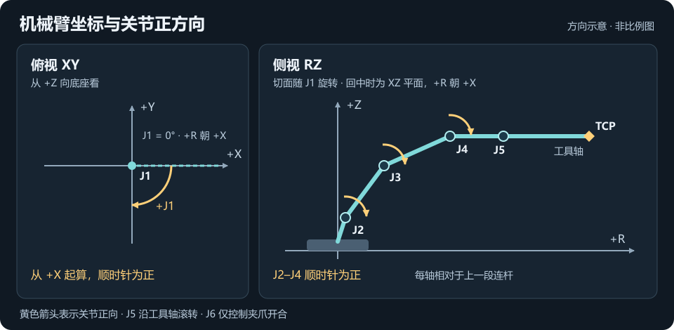

# 机械臂坐标与固件标定



## 坐标与正方向

- **底座 XYZ**：原点在 J1 转轴与桌面参考面的交点。Z 向上，距离用 mm。
- **J1 底座**：俯视时 +X 向右、+Y 向上。J1 从 +X 起算，俯视 **顺时针为正**。
- **J2～J4 俯仰**：在 **+R 向右、+Z 向上**的侧视图中，**顺时针为正**。每轴相对上一段连杆计角。
- **RZ 切面**：随 J1 转动。J1 为 `0°` 时是 XZ 平面，`R = X`。
- **J5 滚转**：从 TCP 朝手腕看，绕工具轴逆时针为正。
- **零位**：J1～J5 的关节偏角 `0°` 对应舵机角 `135°`。工具竖直朝上时俯仰为 `0°`，朝 +R 偏转为正。
- **J6 夹爪**：张开命令 `60°`，闭合命令 `133°`。命令增大时 ADC 原始值下降，换算后的反馈角增大。

## ADC 两点标定

1. **确认 J1～J5 的机械方向**：小幅增加网页目标偏角。若实机转向和图相反，只把 [model.json](../WebHost/model.json) 对应轴的 `commandDirection` 改成相反的符号，再刷新网页。ADC 的增减设置不参与模型转向。
2. **记录两点**：在安全行程内取两个稳定位置，分别记录舵机角和 ADC 原始值。两点 ADC 必须不同。
   - 网页 J1～J5：`舵机角 = 135 + commandDirection × 网页偏角`。
   - 网页 J6 直接用目标角。SWD 可读 `target_deg` 和 `feedback_adc`。
3. **写入固件**：修改 [servo_config.h](../Servo_Arm/Application/Inc/servo_config.h) 的 `SERVO_Jx_ADC_CALIBRATION`。角度和 ADC 保持原始配对；斜率由两点决定。
4. **烧录复核**：用两点之间的第三个位置检查目标与反馈是否接近、变化是否同向。复核前保持 ADC 外环关闭。

宏格式：`SERVO_ADC_CALIBRATION(舵机角A, ADC_A, 舵机角B, ADC_B)`。

```c
/* 示例：数值需换成该轴实测值 */
#define SERVO_J1_ADC_CALIBRATION SERVO_ADC_CALIBRATION(150.0f, 1900U, 120.0f, 2400U)
```
